  

  
  
  

  

  

### `$ ls ~/arsenal`

  
  
  
  
  
  
  
  

### `$ git log --graph --all`

  
    
  <picture>
    <source media="(prefers-color-scheme: dark)" srcset="https://raw.githubusercontent.com/emrekybs/emrekybs/output/snake-dark.svg"/>
    <source media="(prefers-color-scheme: light)" srcset="https://raw.githubusercontent.com/emrekybs/emrekybs/output/snake-light.svg"/>
    
  </picture>

  

 

  
  
  
  

